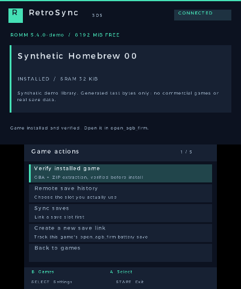
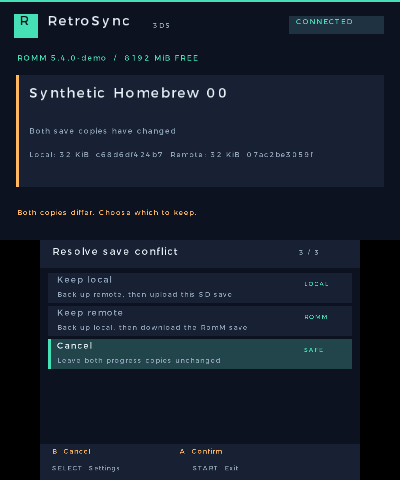

# RetroSync 3DS

## What is it?

RetroSync 3DS brings your self-hosted [RomM](https://romm.app/) library to a **New Nintendo 3DS**.
V1 focuses on downloading GBA games and keeping their battery saves in sync with **open_agb_firm**.

## What does it do?

- Browse and search your platforms and games with a native dual-screen interface.
- Sign in with your **username and password**. No API token to type; sessions renew automatically.
- Download a GBA ROM, or a ZIP containing one GBA ROM, and verify it before installation.
- Track installed games and local save changes separately for each RomM account.
- Sync a chosen battery-save slot in both directions, with **Keep local / Keep remote / Cancel** when both copies changed.
- Keep backup copies before replacing saves, and preserve RomM version history.

V1 downloads and synchronizes **GBA games only**. Other platforms can be browsed, but cannot be installed or synchronized.

 

Native Azahar captures using a synthetic demo library.

## Installation

You need a New Nintendo 3DS with **Luma3DS and FBI**.

### QR code

Open **FBI → Remote Install → Scan QR Code**, then scan:

This installs the [latest CIA](https://github.com/Que20/retroSync-3ds/releases/latest/download/RetroSync3DS.cia)
from GitHub. No local server is needed.

### USB / SD card

1. Download [RetroSync3DS.cia](https://github.com/Que20/retroSync-3ds/releases/latest/download/RetroSync3DS.cia).
2. Power off the console and connect its SD card using a **USB SD card reader**.
3. Copy the CIA into `/cias/`, put the card back, then use **FBI → SD → cias → RetroSync3DS.cia → Install CIA**.

Launch RetroSync from the HOME Menu. A Homebrew Launcher `.3dsx` is also included in the release ZIP.

## How to use

### First launch

1. Open **Settings** with SELECT. Enter your RomM URL, username and password, then choose **Sign in**.
2. Browse to a GBA game and choose **Download game**. The default folder is `/roms/gba/`;
   RetroSync gives each ROM a stable filename to avoid collisions.
3. Set up [open_agb_firm](https://github.com/profi200/open_agb_firm#setup) separately to play the downloaded ROM.
   RetroSync does not launch games or install a game runner.
4. Link the game's battery save using one of the workflows below, then sync before playing.

D-pad selects; A opens; B returns or cancels a transfer; L/R changes game pages; Y searches; START exits.
Tap a selected row to open it.

### Link and sync a battery save

A **battery save** is the progress written by the game's own Save menu, commonly stored as `.sav` or `.srm`.
A **save state** is an emulator snapshot; it is not interchangeable with a battery save.

**If you already have a battery save in RomM:**

1. Open the installed game's **Remote save history**, select the named slot you use, then press A to link it.
   Archival entries without a nonempty slot are history only and cannot be linked directly.
2. Confirm **Save chip** and **Remote format**. Choose **Raw emulator (mGBA / VBA)** for a verified raw
   emulator battery save, or **open_agb_firm** for that runner's byte format. EEPROM requires its verified
   size (512 bytes or 8 KiB); an extension or file size alone does not establish the format.
3. Choose **Link and sync**. If only the remote copy exists, RetroSync imports it into the configured
   open_agb_firm save path. If the existing copies differ and a choice is requested, review it before proceeding.

**If you are starting from a local open_agb_firm save, or starting a new slot:**

1. For a local save, play the downloaded ROM in open_agb_firm and save using the game's own Save menu,
   then return to RetroSync.
2. Open **Create a new save link**. Confirm the chip type, remote byte format and a nonempty **Remote slot**
   (for example, `autosave`). New links default to the raw mGBA format used by RomM/EmulatorJS for GBA.
3. Choose **Link and sync** to upload an existing local save or import an existing remote save.
   If neither copy exists yet, make an in-game save in open_agb_firm, return and choose **Sync saves**.
   Reusing a remote slot still checks its existing content; it does not force an overwrite.

RetroSync reads open_agb_firm's configured save folder and local save slot. The **Remote slot** names the
RomM save slot; it is separate from open_agb_firm's local numbered slot. If the local path, slot or chip
configuration changes, review and relink before continuing.

### Sync before and after playing

1. Before playing, open the game in RetroSync and choose **Sync saves** to compare the local and remote copies.
2. Play the installed ROM in open_agb_firm. Use the game's own Save menu, then return to RetroSync.
3. Choose **Sync saves** again to send the changed local battery save to RomM.
4. On another device, use the same game's battery save in the linked RomM slot and producer format.
   After saving there, make sure its updated battery save reaches that RomM slot before syncing the 3DS again.

Sync is **manual and per game**; RetroSync does not run in the background. When both copies have changed:

- **Keep local** preserves the current remote bytes and uploads the 3DS battery save.
- **Keep remote** backs up the local battery save and installs the RomM copy.
- **Cancel** leaves both copies unchanged and is selected by default.

Sync compares content against the last successful baseline, rather than automatically trusting the newest timestamp.
Missing copies do not automatically propagate a deletion. Backups and RomM history are retained.

### What about save states?

**V1 cannot download, upload or synchronize save states.** open_agb_firm has no save-state workflow in RetroSync.
If your progress exists only in a state, load it in the emulator that created it and use the game's own Save menu
if the game supports saving. Export/upload the resulting compatible **battery save** into a named RomM slot,
then link that slot as described above. RetroSync does not convert a state file into a battery save.

## Compatibility and limitations

| Platform / runner / format | V1 support |
| --- | --- |
| New Nintendo 3DS + **open_agb_firm** | Supported local GBA target: ROM downloads, configured battery-save paths and two-way save sync. Physical-console/gameplay validation is still pending. |
| **RomM / EmulatorJS GBA (mGBA)** | Raw battery-save representation supported on the RomM side. Choose the matching named slot and raw format; save states are excluded. |
| **mGBA / VBA** battery-save files | Compatible raw bytes can be exchanged through RomM after verifying the game, chip type and representation. No direct desktop-emulator integration or folder discovery. |
| **RetroArch / other 3DS emulators** | No local path/core adapter in V1; RetroSync does not discover or manage their saves. A raw battery file is usable only if its format is verified separately. |
| Other platforms (GB/GBC, NES, SNES, NDS, 3DS, etc.) | Library browsing/search/history only. No game installation or save synchronization. |

- **GBA only:** one raw `.gba`, or a ZIP containing exactly one `.gba`. Maximum 64 MiB downloaded archive /
  32 MiB extracted ROM; encrypted archives and other archive formats are unsupported.
- **Battery saves only:** SRAM 32 KiB, FLASH 64/128 KiB, EEPROM 512 bytes/8 KiB. Unknown formats, compressed
  save containers and save states are unsupported. The same game/revision and a verified chip/byte format are required.
- **Server:** save writes target RomM **5.4.0**. Login supports normal username/password accounts;
  browser-only OIDC/SSO login is unsupported. No manual API-token entry is needed.
- **Hardware:** targets New Nintendo 3DS with Luma3DS; original 3DS/2DS models are not validated targets.
  Game runners, BIOS files where required, and legally obtained games must be supplied separately.
- **Scope:** no automatic launching, background/bulk sync, automatic deletion sync, or automatic backup pruning.
  Histories above 512 entries / 512 KiB and individually oversized metadata can exceed V1's bounded-memory limits.

## Features / TODO

Checked items are available in V1. Unchecked items are proposed work, not supported features or release dates.
The platform priorities below are engineering estimates: an existing emulator does not establish RetroSync save compatibility.

### Available today

- [x] Username/password login, session renewal, library browsing and search.
- [x] Verified GBA/ZIP downloads and persistent per-account installation tracking.
- [x] open_agb_firm battery-save tracking, explicit byte-format conversion and manual two-way RomM sync.
- [x] Conflict choices, local backups, retained remote history and interrupted-transfer safeguards.
- [x] Native dual-screen UI and FBI QR / SD-card installation.

### Realistic platform expansion

These are **future adapter candidates** on New Nintendo 3DS. V1 remains GBA-only.
Performance and game compatibility belong to the chosen runner; ROM transfer and portable save compatibility
must be validated separately, including the producer used by RomM on other devices.

| Candidate | Existing runner / primary reference | Assessment and work needed in RetroSync |
| --- | --- | --- |
| **GB / GBC** | [GameYob through TWiLight Menu++](https://wiki.ds-homebrew.com/ds-index/emulators) | Best first expansion: small ROMs and file-based battery saves. Add `.gb`/`.gbc` checks, configured paths, mapper/save-size validation and RTC handling where applicable. |
| **NES** | [VirtuaNES for 3DS](https://github.com/bubble2k16/emus3ds/blob/master/readme-virtuanes.md) | Strong candidate. Add ROM/mapper checks and battery-save mapping; many games have no battery save to sync. States are a separate format. |
| **SNES** | [Snes9x for 3DS](https://github.com/bubble2k16/snes9x_3ds) | Realistic, with per-game performance limits, especially enhancement-chip games. Add ROM checks and validate SRAM layout against the remote producer. |
| **Mega Drive / Genesis, Master System** | [PicoDrive for 3DS](https://github.com/bubble2k16/emus3ds/blob/master/readme-picodrive.md) | Realistic cartridge targets. Validate ROM encodings, SRAM/EEPROM layout and byte order; start with single-file cartridge games. |
| **Nintendo DS** | [TWiLight Menu++ / nds-bootstrap](https://github.com/DS-Homebrew/TWiLightMenu) | High-value native DS-mode target, without DS emulation overhead. Add `.nds` validation, larger streamed downloads, configured save locations/slots and raw save sizing; emulator containers need explicit conversion. |
| **PC Engine / TurboGrafx-16** | [TemperPCE for 3DS](https://github.com/bubble2k16/emus3ds/blob/master/readme-temperpce.md) | Plausible later cartridge target. Validate backup-memory layout; CD games require a separate multi-file/BIOS-aware design. |
| **Native Nintendo 3DS saves** | [Checkpoint exports](https://github.com/bernardogiordano/Checkpoint) | Separate, more complex project: map an installed title to a RomM game and sync exported backup directories with explicit restore steps. Copying a `.3ds` file is not title installation, and live title save archives are not ordinary `.sav` files. |
| **PlayStation** | [PCSX ReARMed on RetroArch 3DS](https://docs.libretro.com/guides/install-3ds2ds/) | Experimental, lower priority. Performance varies by game/build; large disc images, multi-file/multi-disc layouts, BIOS requirements and memory-card formats add substantial work. |

Recommended order: **validate GBA on hardware → build reusable runner profiles → GB/GBC → NES/SNES/Mega Drive → DS**.
DS is also a good earlier branch if it is the main use case. CD systems and native 3DS save management come later.
RetroSync is a library/sync client: adding a platform does not add or improve an emulator.

### Next priorities

- [ ] Complete real-console acceptance: FBI/HOME boot, Wi-Fi, sleep/resume, cancellation and SD error recovery;
  verify actual gameplay round trips for each supported GBA battery type.
- [ ] Replace GBA-specific installation/save assumptions with tested platform and runner profiles:
  extensions, validation, ROM/save paths, save encodings and RomM producer identity.
- [ ] Add GB/GBC first, with local/remote gameplay fixtures and conflict/recovery tests before marking it supported.
- [ ] Add explicit adapters for selected RetroArch cores and standalone runners; honor configured save-directory overrides.
- [ ] Add a save-link wizard with clearer format guidance, local-file discovery and a preview of which copy will change.
- [ ] Expose retained backups/history in the UI with restore previews and optional retention limits.

### Later improvements

- [ ] Offline installed-game view, cached library metadata, resized cover art and filters for installed/changed games.
- [ ] Download queue, bulk-sync preview and progress/ETA while RetroSync is open; retain per-game conflict decisions.
- [ ] Resume interrupted downloads only when server range support and file-identity checks make it safe.
- [ ] Broader tested RomM-version support, negotiated sync sessions and browser sign-in/pairing if the server supports it.
- [ ] Investigate save-state backup for runners that support it, scoped to an exact compatible core/build and ROM hash.
  No universal state conversion or cross-emulator state sync is promised; open_agb_firm remains battery-save-only.
- [ ] Optional runner launch/return integration where supported, and release-update notification with an FBI install handoff.

Detailed V1 acceptance status: [development checklist](docs/TASKS.md).

## Notes

- Save writes target **RomM 5.4.0**. The account needs library, asset and device read/write permissions; no admin privileges are required.
- HTTPS validates the certificate and hostname. Passwords are not saved; session credentials are readable by someone with the SD card.
- Original save bytes and replacement backups are retained. An uncertain upload is checked against server history before another write; deletion is never synchronized automatically.
- For battery-save format limits, recovery and test coverage, see the [V1 guide](docs/V1.md).
- Real-server integration is tested; physical-console/FBI and real gameplay round trips remain a hardware acceptance step.
- No games, BIOS files, saves or credentials are distributed. Licensed under [MIT](LICENSE); see [dependency notices](THIRD_PARTY.md).

## Links

- [Downloads and releases](https://github.com/Que20/retroSync-3ds/releases)
- [RomM documentation](https://docs.romm.app/latest/) · [open_agb_firm setup](https://github.com/profi200/open_agb_firm#setup)
- [V1 guide](docs/V1.md) · [Build and test results](docs/BUILD_VERIFICATION.md)
- [Hardware acceptance](docs/HARDWARE_TEST_PLAN.md) · [API reference notes](docs/API_COMPATIBILITY.md)
