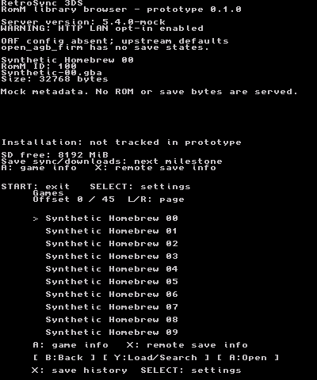
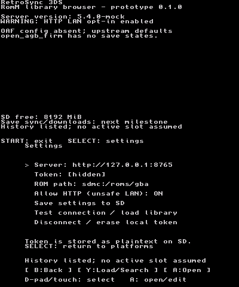
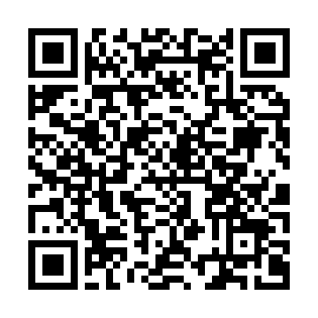

# RetroSync 3DS

## What is it?

RetroSync 3DS is a homebrew client for a self-hosted [RomM](https://romm.app/) library, designed for the
**New Nintendo 3DS**. Its long-term goal is to download games and sync saves, starting with GBA and open_agb_firm.

## What does it do?

The current prototype lets you:

- Browse your RomM library by platform, with search and pagination.
- View game details and remote save history across both screens.
- Configure your server and API token, and test the connection over Wi-Fi.
- Connect over HTTPS with certificate validation.

**ROM downloads and save synchronization are not implemented yet.**

Real application captures from **Azahar 2126.2**, using synthetic RomM API data. These are not mockups or hardware tests.

| Game library | Settings |
| --- | --- |
|  |  |

[More screenshots and setup instructions](docs/SCREENSHOTS.md).

## Installation

You need a New Nintendo 3DS with **Luma3DS and FBI**.

### QR code

Connect the console to the Internet, open **FBI → Remote Install → Scan QR Code**, and scan:

The QR downloads the [latest CIA](https://github.com/Que20/retroSync-3ds/releases/latest/download/RetroSync3DS.cia)
from GitHub. No computer or local server is needed.

### USB / SD card

1. Download [RetroSync3DS.cia](https://github.com/Que20/retroSync-3ds/releases/latest/download/RetroSync3DS.cia).
2. Power off the console and connect its SD card to your computer using a **USB SD card reader**.
3. Copy the CIA into the `/cias/` folder on the card; create that folder if needed.
4. Put the SD card back in the console, turn it on, then open **FBI → SD → cias → RetroSync3DS.cia → Install CIA**.

After either method, launch **RetroSync 3DS** from the HOME Menu.

### First launch

Press **SELECT** to open Settings. Enter your RomM server URL and a client API token with
`platforms.read`, `roms.read`, and `assets.read` scopes. Choose **Save settings**, then
**Test connection / load library**. No emulator is needed to test the current browser.

## Notes

- This is an early prototype. Builds and automated tests pass; installation and operation on real hardware remain unverified.
- Tokens are stored as plaintext on the SD card. Use a scoped token and revoke it in RomM if necessary.
- open_agb_firm is the first planned save-sync target. It does not support save states; RetroArch support is planned later.
- No games, BIOS files, saves, or credentials are included.
- Licensed under [MIT](LICENSE); dependency notices are in [THIRD_PARTY.md](THIRD_PARTY.md).

## Links

- [Downloads and releases](https://github.com/Que20/retroSync-3ds/releases)
- [RomM documentation](https://docs.romm.app/latest/) · [open_agb_firm setup](https://github.com/profi200/open_agb_firm#setup)
- [Roadmap](docs/TASKS.md) · [Architecture](docs/ARCHITECTURE.md)
- [Screenshots and emulator setup](docs/SCREENSHOTS.md)
- [API compatibility](docs/API_COMPATIBILITY.md) · [Emulator and save formats](docs/EMULATOR_MATRIX.md)
- [Build and test evidence](docs/BUILD_VERIFICATION.md) · [CIA packaging](docs/CIA_PACKAGING.md) · [Hardware test plan](docs/HARDWARE_TEST_PLAN.md)
