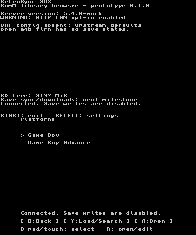
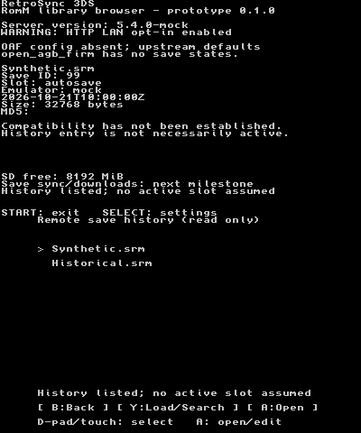

# Screenshots and emulator setup

Captured on **2026-10-22** using the unmodified RetroSync 3DS 0.1.0 `.3dsx` in **Azahar 2126.2**, macOS Apple Silicon.
These are native 400 × 480 PNG captures of the two screens, exported by the emulator without editing.
The catalog and saves are synthetic responses from `scripts/mock_romm.py`; no real RomM credentials or game data were used.

| Platforms | Games |
| --- | --- |
|  |  |

| Remote save history | Settings |
| --- | --- |
|  |  |

## What was verified

- The release 3DSX boots and renders both screens in Azahar.
- Controller-key navigation opens platforms, games, save history and settings.
- The ARM application's HTTP client connects through the emulator to the loopback mock server and parses its responses.
- The fake token is masked in the UI. No real account was accessed.

This does **not** establish physical-console compatibility, CIA installation/HOME launch, real Wi-Fi reliability,
ARM TLS validation or live RomM compatibility. The demo deliberately uses loopback HTTP; the warning shown in the
captures is expected. ROM downloads and save synchronization remain unimplemented.

## What to install

Use [Azahar's official releases](https://github.com/azahar-emu/azahar/releases). On an Apple Silicon Mac choose
`azahar-macos-arm64-2126.2.zip` for the version used here. mGBA and melonDS do not emulate the 3DS application.
The archive was downloaded into the ignored `build-host/azahar/` directory for these captures; no global installation
was made. You can move the official application to Applications for normal use.

The downloaded archive SHA256 was checked against the GitHub release asset digest:
`c24dec2bd5111b7d79513d686c5aece6612cdbf9737b2e6ea99cfc426f1d4aef`.
No external firmware or BIOS dump was needed to run this homebrew 3DSX in this session.

## Reproduce the demo

1. Open Azahar once to create its user directory. Open its user folder through the File menu if using a custom path.
   The default virtual SD path observed on macOS is `~/Library/Application Support/Azahar/sdmc`.
2. Prepare the virtual SD with the provided helper (it refuses to replace different existing settings):

   ```sh
   python3 scripts/prepare-emulator-demo.py --sdmc "$HOME/Library/Application Support/Azahar/sdmc"
   ```

3. Start the metadata-only server in another terminal:

   ```sh
   python3 scripts/mock_romm.py --bind 127.0.0.1 --port 8765
   ```

4. In Azahar, choose **File → Load File** and select `RetroSync3DS.3dsx` from the build or release ZIP.
5. Press the key mapped to the 3DS **Y** button to connect, select **Game Boy Advance**, then press **A**.
   The demo contains 45 synthetic games and two save-history entries. It never serves ROM/save bytes.
6. To capture, open Azahar Preferences → General, set **Save Screenshots To** to an existing folder, and save the setting.
   Choose **Tools → Capture Screenshot**, or **Cmd+P** on the tested Mac configuration. Wait for the view to finish
   drawing before exporting, and inspect the PNG for a complete frame. This produces the emulator framebuffer,
   without desktop windows or emulator chrome.

Default Azahar keyboard mappings observed in this version:

| 3DS input | Keyboard |
| --- | --- |
| A / B | A / S |
| X / Y | Z / X |
| D-pad up / down / left / right | T / G / F / H |
| L / R | Q / W |
| SELECT / START | N / M |

Check Azahar's control preferences if your mappings differ. Stop the mock server with Ctrl-C when finished.

## Real-server or console captures

For live RomM testing, use a dedicated read-only client token (`platforms.read`, `roms.read`, `assets.read`).
Real server/account details and library metadata may appear in captures: review them before publication and never
commit the token or virtual SD contents. The screenshots here require no real token.
Screenshots taken on physical hardware should be labeled separately from emulator evidence.
